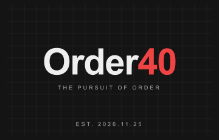
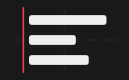
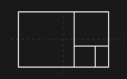
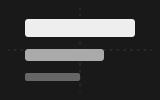
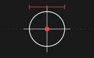
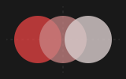

<!-- Order40 project cover -->

  

有些东西，明明已经对齐，看起来仍差一点。\
那一点偏差，小到很难指给别人看，却一直在那里。\
Order40 记录这些感觉，也记录它们如何被理解、被修正，或者被重新定义。

Some things are aligned, yet still feel slightly off.\
The difference is too subtle to point out, yet it’s always there.\
Order40 documents these impressions—and how they are understood, corrected, or redefined.

<table style="width: 775px; max-width: 100%; border-collapse: collapse; border: 0;">
  <tr style="border: 0; background: transparent;">
    <td style="padding: 0 13.75px 12px; border: 0; vertical-align: top;">
       
      Alignment · 各有所依
    </td>
    <td style="padding: 0 13.75px 12px; border: 0; vertical-align: top;">
       
      Proportion · 大小之间
    </td>
  </tr>
  <tr style="border: 0; background: transparent;">
    <td style="padding: 0 13.75px 12px; border: 0; vertical-align: top;">
       
      Consistency · 重复之后
    </td>
    <td style="padding: 0 13.75px 12px; border: 0; vertical-align: top;">
       
      Hierarchy · 不言自序
    </td>
  </tr>
  <tr style="border: 0; background: transparent;">
    <td style="padding: 0 13.75px 12px; border: 0; vertical-align: top;">
       
      Precision · 分毫之内
    </td>
    <td style="padding: 0 13.75px 12px; border: 0; vertical-align: top;">
       
      Harmony · 彼此成立
    </td>
  </tr>
</table>
